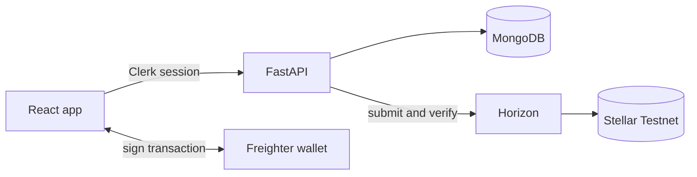
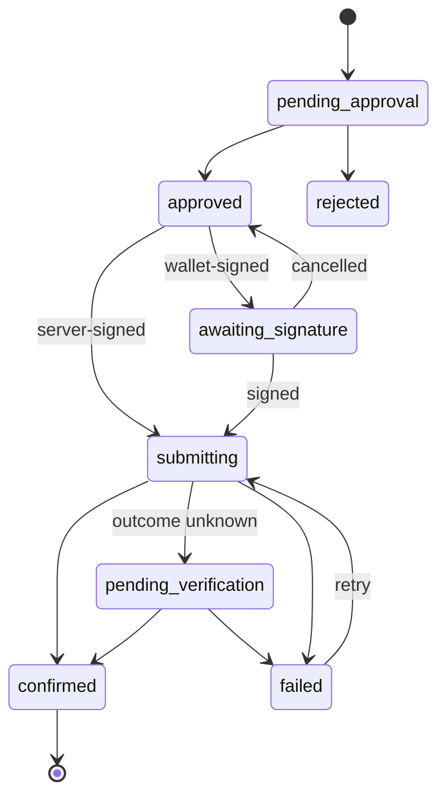

# AGOS

[](https://github.com/barschia-dev/agos-app/actions/workflows/backend.yml)
[](https://github.com/barschia-dev/agos-app/actions/workflows/frontend.yml)

**Business finance on Stellar.** AGOS takes a business payment from request to approval, settles it on Stellar Testnet, checks the result against the ledger and reconciles it, with an audit trail at each step.

> [!IMPORTANT]
> AGOS runs on **Stellar Testnet only**. Cards and domestic transfers are simulated, and no real money moves.

[Features](#features) · [Architecture](#architecture) · [How it works](#how-it-works) · [Run locally](#run-locally) · [API](#api) · [Tests](#tests) · [Security](#security)

## Features

| Area | What it does |
| --- | --- |
| **Workspaces** | Isolated business workspaces with owner, finance manager and employee roles |
| **Expenses** | Submission, receipts, budget warnings and approval routing |
| **Budgets** | Business, department and employee budgets with usage alerts |
| **Cards** | Simulated cards with limits, freezing and automatic expense records |
| **Payments** | Stellar Testnet payments signed by the server or a Freighter wallet |
| **Verification** | Compares the ledger's operations with the approved request |
| **Reporting** | Dashboard, reconciliation, CSV exports and an audit log |

## Architecture



| Part | Technology |
| --- | --- |
| Backend | Python 3.11+, FastAPI, Motor (MongoDB), Stellar Python SDK |
| Frontend | React 19, Tailwind CSS, shadcn/ui, Recharts |
| Sign-in | Clerk |
| CI | GitHub Actions, pytest, Ruff |

## How it works



**A payment is claimed atomically before it is submitted**, so repeated or simultaneous requests do not send it twice:

```python
async def claim_payment(ctx: dict, pid: str, from_statuses: list, to_status: str, key: str):
    await db.payments.update_one({"id": pid, "stellar": None}, {"$set": {"stellar": {}}})
    return await db.payments.find_one_and_update(
        {"id": pid, "workspace_id": ctx["ws_id"], "status": {"$in": from_statuses}},
        {"$set": {"status": to_status, "stellar.idempotency_key": key}},
        projection=NO_ID,
        return_document=ReturnDocument.AFTER,
    )
```

**The ledger decides whether it matches.** AGOS compares the destination and amount recorded by Stellar with the approved request:

```python
def _ops_match(p: dict, found: dict) -> bool:
    return any(
        o.get("to") == p["destination_address"]
        and o.get("amount") is not None
        and Decimal(o["amount"]) == Decimal(str(p["amount"]))
        for o in found["operations"]
    )
```

If the network times out, the payment waits for verification. Before any retry, AGOS checks whether the earlier transaction already settled.

## Run locally

You need Python 3.11+, Node.js 22, Yarn 1, MongoDB and a Clerk application.

**Backend**

```bash
cd backend
python -m venv .venv
source .venv/bin/activate        # Windows: .venv\Scripts\activate
pip install -r requirements-dev.txt
cp .env.example .env             # then fill in the values
uvicorn server:app --reload --port 8001
```

**Frontend**

```bash
cd frontend
cp .env.example .env
yarn install
yarn start
```

Open http://localhost:3000. The API reference is at http://localhost:8001/docs.

## API

Requests need a Clerk session token and a workspace ID. Request a payment:

```bash
curl -X POST http://localhost:8001/api/payments   -H "Authorization: Bearer $TOKEN"   -H "X-Workspace-Id: $WORKSPACE_ID"   -H "Content-Type: application/json"   -d '{
    "type": "international",
    "recipient_name": "Design Contractor",
    "destination_address": "G...",
    "asset_code": "XLM",
    "amount": "25",
    "purpose": "Invoice 1042"
  }'
```

After approval, submit it with an idempotency key:

```bash
curl -X POST http://localhost:8001/api/payments/$PAYMENT_ID/stellar/submit   -H "Authorization: Bearer $TOKEN"   -H "X-Workspace-Id: $WORKSPACE_ID"   -H "Content-Type: application/json"   -d '{"confirm": true, "idempotency_key": "invoice-1042-attempt-1"}'
```

| Endpoint | Purpose |
| --- | --- |
| `POST /api/payments/{id}/decision` | Approve or reject |
| `POST /api/payments/{id}/stellar/prepare` | Build a transaction for a wallet to sign |
| `POST /api/payments/{id}/stellar/submit-signed` | Submit the signed transaction |
| `POST /api/payments/{id}/stellar/verify` | Check the ledger again |
| `GET /api/reconciliation` | Reconciliation status of every record |

The running server documents every endpoint at `/docs`.

## Tests

```bash
cd backend
pytest
ruff check .
```

These tests run in memory, with no Clerk or Stellar access. The scripts in `backend/tests/live` need a running server and Clerk test keys.

## Project layout

```
backend/
  server.py          entry point
  app/
    config.py        settings from the environment
    database.py      MongoDB client and indexes
    dependencies.py  signed-in user, workspace and role checks
    stellar.py       Horizon access and transaction building
    routers/         API endpoints
    services/        approvals, budgets, settlement and reporting
  tests/
frontend/            React application
docs/                product requirements and design guidelines
```

## Security

- Queries are scoped to the workspace, and roles are checked on the server.
- Finance managers cannot approve their own requests or amounts above their limit.
- Server-held Stellar keys are encrypted at rest. Wallet workspaces store no secret key.
- Connecting a wallet requires signing a challenge that cannot be submitted to the network.
- Secrets come from the environment and are never committed.
